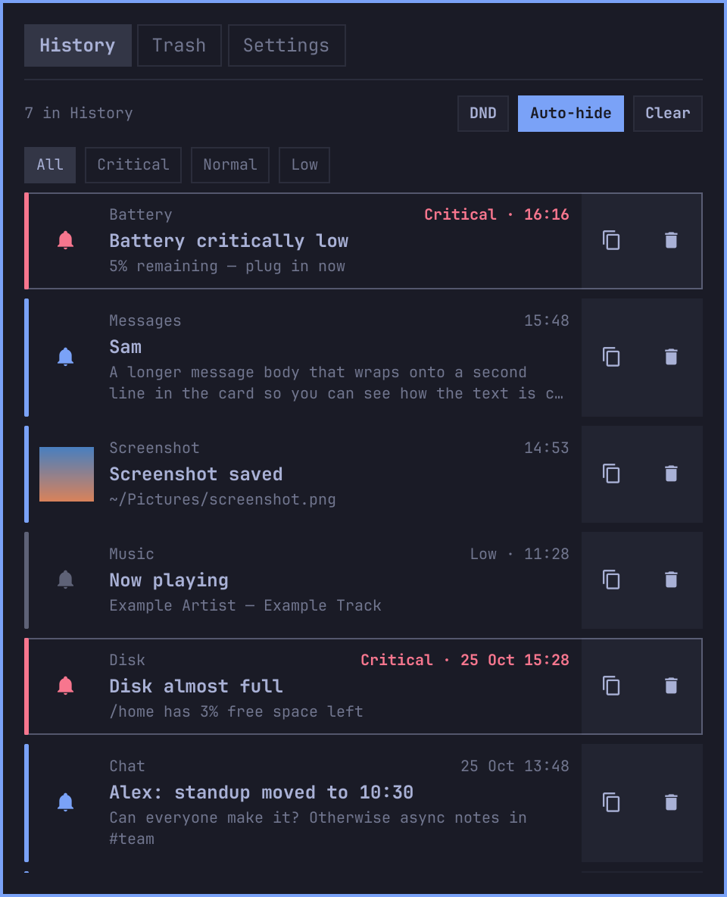
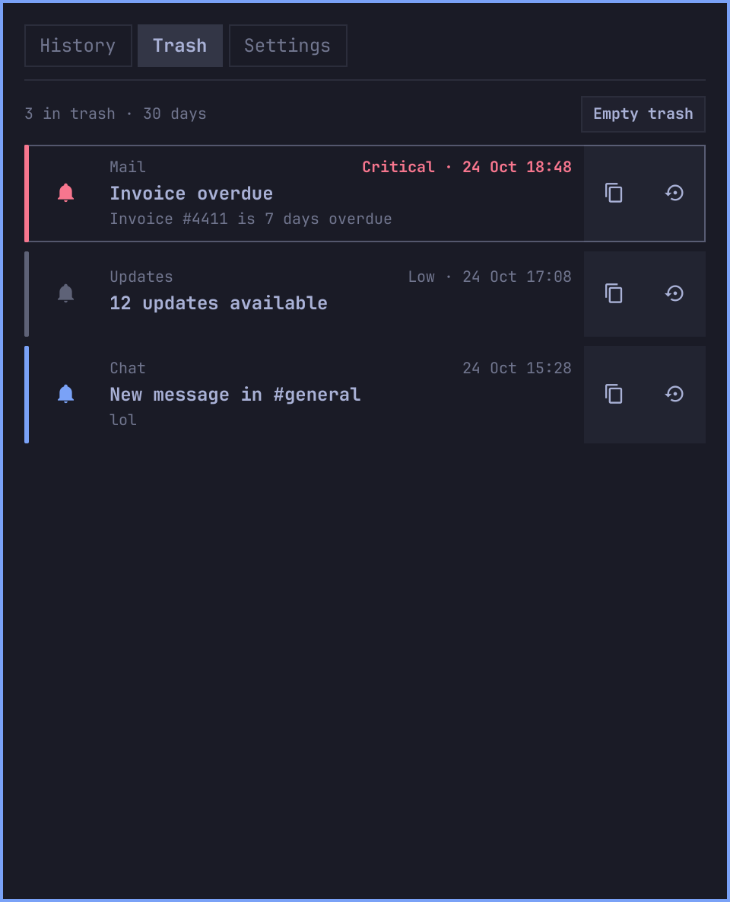
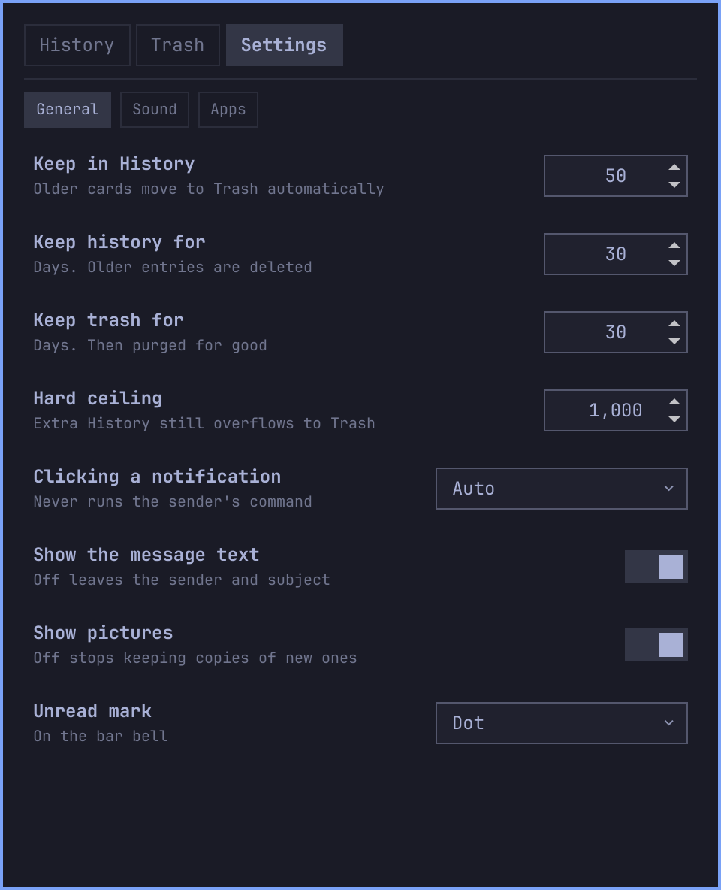

# Yet Another Notification Center

Omarchy bar widget: notification history, trash, sounds, and auto-hide.



- **History**: search (`/`), urgency chips, DND, auto-hide, dismiss to trash
- **Trash**: restore or empty; kept for the days set in Settings
- **Settings**: General, Sound (Play per clip), Apps

| Trash | Settings |
| --- | --- |
|  |  |

Uses Omarchy's `omarchy.notifications` service, so leave it enabled. Disable
any other notification-center widget first, or you get two bells.

Contents: [Requirements](#requirements) · [Omarchy versions](#omarchy-versions) ·
[Install](#install) · [Usage](#usage) · [Settings](#settings) ·
[Development](#development) · [Changelog](#changelog) · [Remove](#remove)

## Requirements

Omarchy with its notification service (`omarchy.notifications`) and
`omarchy-shell`. Most of these ship with Omarchy; Arch package in brackets.

Required:

- `bash`, coreutils (`timeout`, `realpath`, `stat`, `date`, `head`), `awk`, `sed`, `grep`
- `jq` [jq] — the store is JSON
- `flock` [util-linux] — locks the store
- `inotifywait` [inotify-tools] — follows new notifications (`watch` exits without it)

Optional — the feature is skipped or shows an error without it:

- `file` [file] — check notification icons/images before copying them
- `magick` [imagemagick] — shrink large image previews
- `pw-play` [pipewire-audio] + freedesktop sounds [sound-theme-freedesktop],
  or `canberra-gtk-play` [libcanberra] — notification sounds
- `wl-copy` [wl-clipboard] — Copy
- `xdg-open` [xdg-utils] — open a notification's picture
- `omarchy-hyprland-focus-app` (Omarchy) — click a row to focus the app

## Omarchy versions

Works with both notification engines; the plugin picks one at startup.

- **Omarchy 4.0.x** — copies each notification, pictures included, into its
  own history. Nothing changed here.
- **Omarchy 4.5 (Omapager)** — reads the engine's `live.json` / `history.json`
  under `~/.local/state/omarchy/notifications/`. Auto-hide closes toasts
  through the engine (and waits while you hover the stack), and DND follows
  the engine's own switch. Omapager's files keep no pictures and no actions,
  so the plugin gets what it can while a toast is on screen:
  - **Pictures** are saved the moment a toast arrives (inline image data or
    an image file, scaled to 512 px at most), even when Do Not Disturb lets
    the toast go at once. Off with *Show pictures*. Screenshot previews come
    from Omarchy's click command, as on 4.0.
  - **Links**: the first web address in the text, else the site a browser
    notification came from. With *Auto* clicks, a row whose app can't be
    focused opens it.
  - **Actions**: while the toast is still up, clicking its row (*Auto*) runs
    the sender's default action. Once it closes, actions are gone for good.

  Limits: a picture is only saved while the bar widget is loaded; an
  in-place update keeps the first picture; verification-code notifications
  are stored only as Omarchy's placeholder, with no picture or link; the
  plugin never runs Omarchy's `--action` commands.

## Install

```sh
omarchy plugin add https://github.com/Loafer19/omarchy-yet-another-notification-center.git --enable
```

## Usage

Click the bell to open the panel; right-click it to toggle Do Not Disturb.

| Key | Does |
| --- | --- |
| **Tab** | next tab |
| **h** / **l** | previous / next chip (on a Settings row: change its value) |
| **j** / **k** | next / previous row |
| **Enter** | open the row, restore it (Trash) or change the setting |
| **x** | move to Trash (History) or delete for good (Trash) |
| **/** | search History |
| **Esc** | end the search, cancel Empty trash, or close |

Move the bell to another bar section:

```sh
omarchy bar move yoyo.notification-center --section right
```

## Settings

Change settings in the panel's **Settings** tab. They are stored in one place:

```
~/.local/state/omarchy/yoyo.notification-center/settings.json
```

Everything reads and writes that file through the plugin's backend
(`scripts/backend.sh settings-get` / `settings-set`), which fills in defaults
and clamps values using `defaults.js` (shared with the QML). The widget has no
settings in Omarchy's own widget-settings dialog — values there would be a
second copy. You may edit `settings.json` by hand; invalid or out-of-range
values fall back to the defaults in `defaults.js`.

## Development

```sh
tests/run.sh
```

Checks the vendored UI kit, runs the Model.js tests with Node and the
backend tests against a temporary store (your notifications are never
touched). `tests/autohide.sh` runs the real service in Quickshell (`qs`,
offscreen) against a fake toast stack and times auto-hide;
`tests/omapager.sh` does the same against a fake Omarchy 4.5 engine, and
`tests/capture.sh` sends real notifications (pictures, actions, a secret,
DND) to a 4.5-like server on a private D-Bus. Also needs `node`.

Layout:

- `Service.qml`: the store the bar and panel share (entries, DND,
  settings, engine); its parts live in `service/` (actions, auto-hide, live
  toasts, settings, watcher).
- `BarWidget.qml`, `Panel.qml`: the bell and the panel; panel parts in
  `components/`.
- `Model.js` (rows, settings, links), `Nav.js` (keyboard cursor),
  `defaults.js`: pure logic, tested by `tests/model.test.js`.
- `scripts/backend.sh`: the store on disk; one module per job in
  `scripts/lib/` (store, legacy and omapager ingest, images, watch,
  settings, sound), jq programs in `scripts/lib/*.jq`.
- `vendor/yoyo-ui`: the shared [omarchy-yoyo-ui](https://github.com/Loafer19/omarchy-yoyo-ui)
  kit. Don't edit it here; `tools/sync-ui.sh` updates it and
  `tools/sync-ui.sh --check` (part of `tests/run.sh`) checks it.

Lint (both clean): `qmllint` on the plugin's own `.qml` files, and
`shellcheck -x scripts/backend.sh`.

CI (`.github/workflows/ci.yml`) runs `tests/run.sh` on Ubuntu for every push
and pull request; the tests that need `qs` or a session bus skip there.

The screenshots (`preview.png`, `docs/*.png`) are rendered offscreen with
invented notifications: `tools/render-previews.sh` (needs `qs`, `jq`,
`magick` and the Omarchy shell) runs the real service and panel on a
throwaway store from `tests/preview/fixture.sh`, so your own history is never
read.

## Changelog

Full notes on the [Releases](https://github.com/Loafer19/omarchy-yet-another-notification-center/releases) page.

- **1.5.4**: security: Copy hands the text to `wl-copy` on stdin instead of
  its command line, so it no longer shows in `/proc/<pid>/cmdline` of the
  clipboard owner (readable by other local users).
- **1.5.3**: one IPC handler, owned by the service (no duplicate-handler
  warning with several monitors).
- **1.5.2**: marketplace readiness: screenshots re-rendered offscreen from
  made-up notifications (`tools/render-previews.sh`), CI on every push, a
  License section; no behaviour change.
- **1.5.1**: code split into `service/`, `components/` and
  `scripts/lib/`, with no behaviour change; more tests (cursor, setting
  changes, backend error paths); qmllint and shellcheck clean. Visual: the
  History and Trash header lines sit flush with the tabs and cards, and
  empty lists say what to do next.
- **1.5.0**: Omarchy 4.5 (Omapager) support: history from the engine,
  pictures saved while a toast is up, links, the sender's default action.
- **1.4.0**: per-toast auto-hide; settings live only in the panel; every
  action is checked and failures show in a footer; faster pruning.
- **1.3.1**: omarchy-yoyo-ui v0.2.0; Empty trash confirms with a second click.
- **1.3.0**: shared omarchy-yoyo-ui v0.1.0; theme colours fixed.
- **1.2.6**: DND without flicker; Keep in History moves old cards to Trash.

## Remove

```sh
omarchy plugin remove yoyo.notification-center
rm -rf ~/.local/state/omarchy/yoyo.notification-center
```

## License

MIT — see [LICENSE](LICENSE).
